# PaperPilot 📄

**A retrieval-augmented generation (RAG) assistant that answers questions about research papers — and cites the exact paper and page for every claim.**

PaperPilot finds papers on **any topic you type** (searching arXiv, Semantic Scholar and OpenAlex), splits them into page-aware chunks, embeds them into a vector database, and answers questions with an LLM that is only allowed to use the retrieved passages. If the papers don't contain the answer, it says so instead of guessing.

The project includes a measurable **evaluation harness**: retrieval quality (Recall@k, MRR) across chunking strategies and re-ranking, plus citation accuracy and refusal behaviour of the full pipeline.

---

## Architecture

```mermaid
flowchart LR
    T[Topic in plain English] -->|research.py<br/>LLM query expansion| QX[4-6 search queries]
    QX --> S1[arXiv] & S2[Semantic Scholar] & S3[OpenAlex]
    S1 & S2 & S3 -->|sources.py| DD[Dedup by DOI / arXiv id / title<br/>rank by embedding similarity + citations]
    DD -->|open-access PDFs| B
    A[arXiv API] -->|download.py| B[PDFs]
    B -->|loaders.py<br/>PyMuPDF| C[Pages]
    C -->|chunking.py<br/>page-aware, overlapping| D[Chunks + metadata]
    D -->|embeddings.py<br/>sentence-transformers| E[(ChromaDB)]
    Q[Question] --> R[retriever.py<br/>vector search → optional cross-encoder re-rank]
    E --> R
    R -->|top-k sources| L[llm.py<br/>Claude / Ollama]
    L --> O[Answer with S1, S2 tags]
    O -->|rag.py| P[Answer + paper/page citations]
    P --> API[FastAPI /ask] --> UI[Streamlit UI]
```



| Step | File | What it does |
|---|---|---|
| 1 | `paperpilot/research.py`, `sources.py` | **Topic research:** expands a topic into several queries with the LLM, searches three paper databases, removes duplicates, ranks by relevance, downloads open-access PDFs and indexes them, tagged with the topic |
| 1 | `paperpilot/download.py` | Simple single-query arXiv download (saves PDFs + `metadata.jsonl`) |
| 2 | `paperpilot/loaders.py`, `chunking.py` | Extracts text per page, cleans it, cuts it into overlapping chunks that never cross a page, drops reference lists |
| 2 | `paperpilot/embeddings.py`, `store.py`, `ingest.py` | Embeds chunks and stores them in ChromaDB (one collection per chunking setting) |
| 3 | `paperpilot/retriever.py` | Vector search; optional two-stage re-ranking with a cross-encoder |
| 3 | `paperpilot/prompts.py`, `llm.py`, `rag.py` | Builds a numbered-source prompt, calls the LLM, maps `[S1]` tags back to paper + page, ignores invented tags, refuses when unsupported |
| 4 | `paperpilot/evaluate.py` | Generates a question set, measures retrieval and answer quality, writes Markdown reports to `eval/` |
| 5 | `paperpilot/api.py`, `app/streamlit_app.py` | REST API (`/ask`, `/topics`, `/research`, `/health`, docs at `/docs`) and a web UI with an Ask tab and a Research tab |

---

## Quick start (Windows PowerShell)

```powershell
cd PaperPilot
python -m venv .venv
.\.venv\Scripts\Activate.ps1
pip install -r requirements.txt

copy .env.example .env      # then open .env and add your ANTHROPIC_API_KEY
                            # (or set PP_LLM=ollama to use a free local model)

python -m paperpilot.download --max 50     # ~50 PDFs into data/papers
python -m paperpilot.ingest                # chunks + embeddings into data/chroma
python -m paperpilot.rag "How is the spectral radius of an echo state network chosen?"
```

On macOS/Linux use `source .venv/bin/activate` and `cp` instead of `copy`.

## Research any topic

Type a topic in plain English; PaperPilot does the rest.

```powershell
python -m paperpilot.research "graph neural networks for drug discovery" --max 40
python -m paperpilot.rag "Which message passing architectures work best for molecules?" --topic "graph neural networks for drug discovery"
```

What happens:

1. **Query expansion** – the configured LLM (Claude or Ollama) turns the topic into 4–6 search queries covering synonyms, subtopics and method names. Its JSON output is validated; if it fails (or `PP_LLM=extractive`), a keyword query built from the topic is used.
2. **Multi-source search** – every query runs on arXiv, Semantic Scholar and OpenAlex (`--sources arxiv,openalex` to choose). Rate limits (HTTP 429) are retried with backoff.
3. **Deduplication** – the same paper found by several sources is merged by DOI, then arXiv id, then normalised title, keeping the record that has a PDF link.
4. **Ranking** – `score = similarity(topic, title + abstract) + 0.03 · log(1 + citations)`; papers without an open-access PDF or already in the library are skipped; the top `--max` are kept.
5. **Download** – polite (1 s delay), failures are skipped, nothing is downloaded twice. `metadata.jsonl` gets `source`, `topic`, `abstract`, `doi` and `relevance_score`.
6. **Indexing** – only the new papers are chunked and embedded; every chunk carries its topic, so you can search one topic or all of them.
7. **Report** – `data/research/<topic-slug>.md` lists the queries, results per source, duplicates removed and every paper with its score and link.

Other options: `--no-ingest` (download only), `--per-query 50` (more results per query). Optional settings in `.env`: `PP_S2_API_KEY` (free Semantic Scholar key, higher rate limit) and `PP_CONTACT_EMAIL` (polite contact for OpenAlex/arXiv).

In the web UI, open the **Research a new topic** tab, type a topic, choose the number of papers and watch the progress; afterwards pick the topic in the sidebar's **Search in** dropdown and ask questions. The API runs research as a background job (`POST /research`, then poll `GET /research/{job_id}`), so it stays responsive while papers download.

### Run the API and the web UI

Double-click `start.bat` to start Ollama, the API and the web UI together. It opens http://localhost:8501 in your browser. The API docs are at http://localhost:8000/docs. Close the minimized API and Streamlit windows to stop them.

Or start each part by hand:

```powershell
uvicorn paperpilot.api:app --reload          # terminal 1 → http://localhost:8000/docs
streamlit run app/streamlit_app.py           # terminal 2 → http://localhost:8501
```

### Or with Docker

```powershell
docker compose run --rm api python -m paperpilot.download --max 50
docker compose run --rm api python -m paperpilot.ingest
docker compose up --build                    # API on :8000, UI on :8501
```

---

## Evaluation

```powershell
# 1. Generate ~30 questions from random chunks (the source page is the "gold" answer).
#    Open eval/questions.jsonl afterwards and delete vague or wrong questions.
python -m paperpilot.evaluate generate --n 30

# 2. Compare chunk sizes, with and without re-ranking
python -m paperpilot.evaluate retrieval --configs 200:40,300:50,500:80 --rerank both

# 3. Evaluate full answers: citation accuracy + refusal on out-of-scope questions
python -m paperpilot.evaluate answers
```

**Metrics**

- **Recall@k** – share of questions where the gold page is among the top-k retrieved chunks.
- **MRR** – mean reciprocal rank of the first correct chunk (1.0 = always ranked first).
- **Citation accuracy** – share of answers that cite the gold page.
- **Out-of-scope refusal rate** – share of unrelated questions (`eval/out_of_scope.jsonl`) the system correctly declines.

**Results** – 19 questions, top-5 retrieval, `all-MiniLM-L6-v2` embeddings, LLM `llama3.1` via Ollama. Full tables are in `eval/results_retrieval.md` and `eval/results_answers.md`.

| Chunk size / overlap (words) | Re-ranking | Recall@1 | Recall@5 | MRR |
|---|---|---|---|---|
| 200 / 40 | no | 47% | 74% | 0.58 |
| 200 / 40 | yes | 68% | 79% | 0.73 |
| 300 / 50 | no | 53% | 68% | 0.58 |
| 300 / 50 | yes | 63% | 74% | 0.68 |
| 500 / 80 | no | 16% | 37% | 0.23 |
| 500 / 80 | yes | 26% | 47% | 0.36 |

Answer quality (300 / 50 chunks, no re-ranking):

| Metric | Value |
|---|---|
| In-scope questions answered | 84% |
| Answers citing the correct page | 68% |
| Out-of-scope questions correctly refused | 100% |

With 19 questions, one question moves a recall figure by about 5 points, so the gap between 200 and 300 words is not conclusive. One paper (`2409.07886v3.pdf`) could not be parsed and is missing from the index.

---

## Design decisions

- **Page-aware chunking** – chunks never span two pages, so every citation points to one exact page.
- **Numbered sources, not free-text citations** – the LLM cites `[S1]`, `[S2]`; the code maps tags to paper/page. Tags that don't exist are discarded, so the model cannot fabricate a reference.
- **Explicit refusal** – the prompt requires a fixed refusal sentence when sources are insufficient, and `PP_MIN_SCORE` can refuse before the LLM is even called.
- **Two-stage retrieval** – fast bi-encoder search for 20 candidates, then a cross-encoder re-ranks them for precision.
- **Swappable components** – embeddings and LLM are chosen by environment variables (Claude, local Ollama, or fully offline stubs for tests).
- **One collection per chunking setting** – lets the evaluation compare configurations side by side without re-indexing.
- **Multi-source search behind one interface** – arXiv, Semantic Scholar and OpenAlex each implement `search(query, limit) -> list[PaperCandidate]`, so adding a source is one small class.
- **LLM query expansion with a safe fallback** – one topic becomes several targeted queries (better recall); the JSON is validated, and a keyword query is used if the LLM is unavailable.
- **Deduplication across sources** – DOI → arXiv id → normalised title, merging citation counts and abstracts and keeping the version with an open-access PDF.
- **Relevance ranking** – embedding similarity between the topic and each abstract, plus a small, configurable citation bonus, decides which papers are worth downloading.
- **Topic-tagged chunks** – each chunk stores its research topic, so retrieval can be filtered to one topic (`/ask` with `topic`, `--topic` on the CLI, dropdown in the UI).
- **Background jobs** – long research runs execute in a worker thread; the UI polls their progress instead of blocking the API.

## Tests

```powershell
pytest
```

The tests run fully offline (generated PDFs, hash embeddings, extractive answer stub, mocked HTTP for arXiv, Semantic Scholar and OpenAlex) and cover chunking, retrieval, citation mapping, refusal, the evaluation code, the API, and topic research: query expansion and its fallback, source parsing and 429 backoff, deduplication, ranking, skipping papers without PDFs, backward-compatible metadata, topic filtering and the `/research` and `/topics` endpoints.

## Project structure

```
PaperPilot/
├── paperpilot/          # library code (research/download → ingest → retrieve → answer → evaluate → API)
├── app/                 # Streamlit UI
├── eval/                # questions, out-of-scope set, result reports
├── tests/               # pytest suite (offline)
├── data/                # PDFs, vector index and research reports (git-ignored)
├── Dockerfile, docker-compose.yml
├── requirements.txt, .env.example
└── README.md
```

## Possible extensions

More paper sources (PubMed, CORE), hybrid search (BM25 + vectors), streaming answers, LLM-as-judge for answer faithfulness, conversation memory, and support for uploading your own PDFs through the UI.
